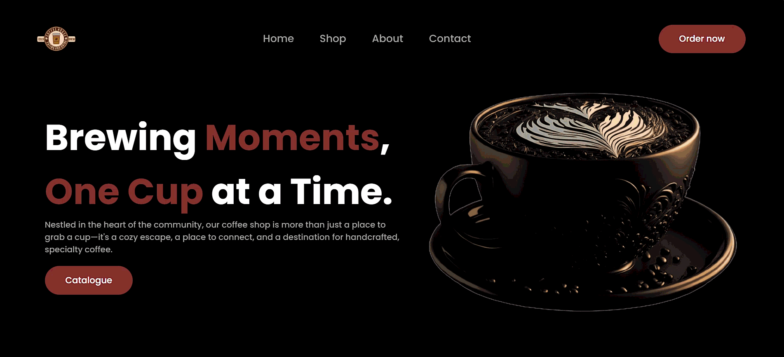

<h1>Landing Page - Coffee Shop</h1>

<h2>Introduction</h2>

This is a modern and responsive landing page for a coffee shop created using React, TypeScript, and Tailwind CSS. It features a clean, attractive UI with custom entry animations that bring the page to life. The project was developed to practice building React functional components, utilizing Tailwind CSS for rapid styling, and implementing custom CSS animations for an engaging user experience.

<h2>Technologies Frameworks</h2>
<ul>
  <li><b>React</b> - UI Library</li>
  <li><b>TypeScript</b> - Programming Language</li>
  <li><b>Tailwind CSS</b> - Utility-first CSS Framework</li>
  <li><b>CSS3</b> - Custom keyframe animations</li>
</ul>

<h2>Screenshots</h2>

  

